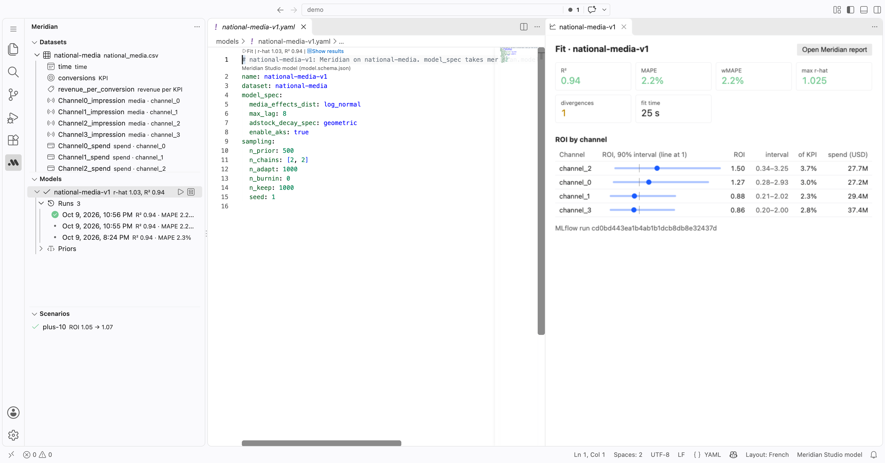
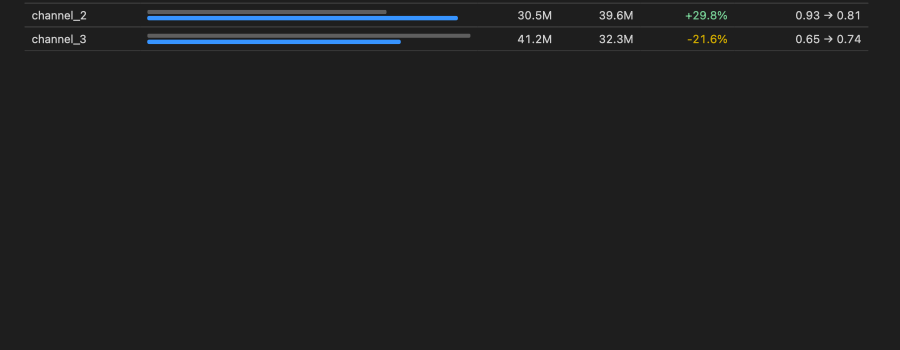

# Meridian Studio

[](https://github.com/lgrosjean/meridian-studio/actions/workflows/test.yml)
[](https://marketplace.visualstudio.com/items?itemName=lgrosjean.meridian-studio)

**Marketing mix modeling, right in your editor.**

Meridian Studio brings [Google Meridian](https://github.com/google/meridian) to VS Code and Cursor. You describe
your data, your models and your budget scenarios in small YAML files, then fit and optimize them with one click.
Every run is tracked in MLflow.

**[Read the documentation →](https://lgrosjean.github.io/meridian-studio/)**



> **Unofficial community project.** Not affiliated with, endorsed by or sponsored by Google. Meridian and the
> Meridian logo are trademarks of Google LLC. Google has its own, unrelated product called
> [Meridian Studio](https://developers.google.com/meridian/studio).

## Why use it

- **Your model is code.** Datasets, models and scenarios are plain YAML files: review them in pull requests and
  keep their history in git.
- **No Python setup.** The first run installs everything Meridian needs, without touching your system Python.
- **Help as you type.** Autocomplete, inline errors and one-click fixes, based on the columns of your own CSV.
- **Data checked before you fit.** Missing weeks, negative spend or a channel that never spends are flagged like
  linter warnings, before a fit wastes your time.
- **Results next to your YAML.** R², MAPE, convergence, ROI per channel, and Meridian's health score for each fit.
- **Every run tracked.** Each fit and optimization is logged to MLflow, on your machine or on your tracking server.

## Install

- **VS Code**: install [Meridian Studio](https://marketplace.visualstudio.com/items?itemName=lgrosjean.meridian-studio)
  from the Marketplace.
- **Cursor, VSCodium**: install [Meridian Studio](https://open-vsx.org/extension/lgrosjean/meridian-studio) from
  Open VSX, in the Extensions view.

## Quick start

1. **Add your data.** Open the folder that holds your weekly CSV, click the Meridian icon in the activity bar, then
   **New dataset** and pick the CSV. Meridian Studio guesses what each column is (dates, KPI, spend per channel…)
   and writes the dataset's YAML. Complete anything it could not guess: autocomplete suggests your columns.
2. **Fit a model.** Click **New model** on that dataset, then **▶ Fit** above the file. The results open beside
   the editor after a few minutes.
3. **Plan a budget.** Click **New scenario** on that model, set a budget, then **▶ Optimize** to see how Meridian
   would split it across your channels.

The first fit downloads Python and Meridian (about 1 GB, a few minutes, only once). Fits run on your machine, on CPU.

No CSV at hand? Open the [`examples/`](examples/) folder: a ready-made project on Meridian's sample data.

## How a project looks

Three folders, one kind of file in each:

| Folder       | Each file describes                                    | Button       |
|--------------|--------------------------------------------------------|--------------|
| `datasets/`  | a CSV, and what each of its columns means              |              |
| `models/`    | a dataset, Meridian's model settings and priors        | ▶ Fit        |
| `scenarios/` | a fitted model, a budget and limits for each channel   | ▶ Optimize   |

A model, for example:

```yaml
name: sales-v1
dataset: weekly-sales
model_spec:
  max_lag: 8
priors:
  roi_m:                       # what you expect each channel's ROI to be
    dist: LogNormal
    default: { mean: 1.0, sd: 1.0 }
    tv: { mean: 1.5, sd: 0.8 }
```

And a scenario that asks: *with 10% more budget, and each channel within ±30% of its current spend, what is the
best split?*

```yaml
name: plus-10
model: sales-v1
budget: +10%
bounds: { lower: 0.3, upper: 0.3 }
```



## Learn more

The [documentation](https://lgrosjean.github.io/meridian-studio/) covers everything in detail:

- [Getting started](https://lgrosjean.github.io/meridian-studio/getting-started/): install, then a first model on
  your own CSV
- Guides: [datasets](https://lgrosjean.github.io/meridian-studio/guide/datasets/),
  [data checks](https://lgrosjean.github.io/meridian-studio/guide/data-checks/),
  [models and fits](https://lgrosjean.github.io/meridian-studio/guide/models/),
  [budget scenarios](https://lgrosjean.github.io/meridian-studio/guide/scenarios/),
  [runs and tasks](https://lgrosjean.github.io/meridian-studio/guide/runs/),
  [checks in CI](https://lgrosjean.github.io/meridian-studio/guide/ci/)
- Reference: every key of the [dataset](https://lgrosjean.github.io/meridian-studio/reference/dataset/),
  [model](https://lgrosjean.github.io/meridian-studio/reference/model/) and
  [scenario](https://lgrosjean.github.io/meridian-studio/reference/scenario/) YAML, every
  [command and setting](https://lgrosjean.github.io/meridian-studio/reference/commands/)
- [Roadmap](https://lgrosjean.github.io/meridian-studio/roadmap/): what Meridian can do that the extension does not
  use yet

## Contributing

Run `bun install`, then press F5: VS Code opens `examples/` with the extension loaded. `bun run test` runs the
tests. How the code is organized, the other test suites, releases and the documentation site are described in
[Development](https://lgrosjean.github.io/meridian-studio/development/).

## License

Apache License 2.0, see `LICENSE` and `NOTICE`. Google Meridian is also Apache 2.0; it is installed when you first
run a fit, not bundled with the extension. The icons in `media/` reproduce the Meridian logo, a Google trademark,
and are not covered by this license.
